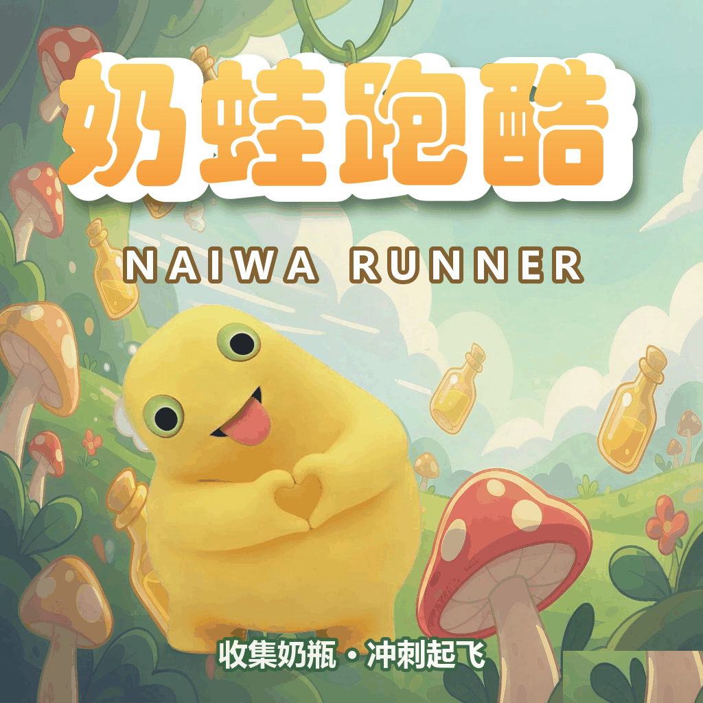

# 奶蛙跑酷 · NAIWA RUNNER

<p align="center">
  
</p>

<p align="center">
  单文件横版跑酷网页游戏 · 所有图片以 base64 内嵌，双击即玩，无需服务器
</p>

<p align="center">
  <a href="https://naiwa-runner-44840.app.workbuddy.host/?sharecode=CW4UHAL3KX">▶ 在线试玩</a>
</p>

---

## 文件说明

| 文件 | 说明 |
|---|---|
| `index.template.html` | **开发入口**，图片位置是 `__IMG_XXX__` 占位符 |
| `index.html` | 构建产物，已内嵌图片 |
| `dist/index.html` | 发布用副本（`build.py --dist` 生成） |
| `assets/` | 切好的奶蛙素材 + `rig.json`（骨骼坐标） |
| `src/` | 原始全身图、切图预览 |
| `promo/` | 宣传物料：`cover.png`（README 封面）、`奶蛙跑酷-宣传图.png`（原图）、`raw/`（生成中间产物） |
| `tools/` | 构建、切图、调试、CDP 测试脚本 |
| `tools/legacy/` | 早期原型，仅作参考 |

---

## 构建

```bash
python tools/build.py            # → index.html
python tools/build.py --dist     # → index.html + dist/index.html
```

## 素材重切

改了 `src/奶蛙-全身.png` 之后：

```bash
python tools/rig_cut.py          # 切成 身 / 左腿 / 右腿，输出 assets/ 与 rig.json
python tools/build.py --dist
```

`rig_cut.py` 里有两个关键处理，改参数前务必读注释：

1. **髋部圆盘补画**：髋线以上重画成「以髋轴为圆心的实心整圆」。整圆绕自身圆心旋转形状不变，
   所以腿怎么摆都不会裂；圆外像素必须裁掉，否则会甩出尖刺。
2. **`drop_specks()`**：清掉与主体不连通的小碎块（原图脚边的泥块残留）。

---

## 渲染架构

- **虚拟坐标**：高度固定 720，宽度 `W` 随屏幕比例伸缩（`resizeCanvas` 里算），
  世界右边缘永远等于屏幕右边缘 → 任意比例铺满无黑边。
- **缩放**：`ctx.setTransform(dpr * viewScale, ...)`，`viewScale = innerHeight / 720`。
- **UI**：DOM 覆盖层，尺寸用 `em`，基准 `font-size: calc(min(100vw, 177.78vh)/100)`。
- **角色**：身体 + 左右腿三张图按骨骼拼装，腿在身体**之下**，绕髋轴旋转。

---

## 玩法参数

| 项 | 值 | 位置 |
|---|---|---|
| 基础速度 | 430 → 910 px/s（随时间线性，约 50s 封顶） | `update()` `targetSpeed` |
| 冲刺 | 集满 8 瓶触发，4.2s，速度 ×1.32 | `ENERGY_MAX` / `BOOST_TIME` |
| 跳跃 | 初速 -1030，重力 2900（跳高 183，滞空 0.71s） | `JUMP_V` / `GRAVITY` |
| 障碍间距 | `speed × (0.98~1.56)`，最小 460 | `nextGap()` |
| 得分 | `距离 × 0.055 + 奶瓶 × 12 + 加成` | `update()` |

蘑菇是可踩平台：落到伞面任意位置都安全，脚底跟随穹顶弧面，0.22s 后自动落回地面。
**只要从伞盖上方掠过，这朵蘑菇就永久对它失效**（`markMushroomPassed`），
避免"身体比伞盖宽导致边缘误判死亡"。只有在地面上不跳、正面撞上去才会死。

---

## 操作

- 手机：**左半屏按住 = 趴下**，**右半屏点击 = 跳跃**（可二段跳）
- 键鼠：空格 / ↑ 跳跃，↓ 滑铲

---

## 测试脚本

全部基于 Chrome DevTools Protocol（`--headless=new` + 原生 WebSocket）。

| 脚本 | 用途 |
|---|---|
| `fs.mjs` | 多分辨率自适应验证 |
| `shoot3.mjs` | 桌面 / 手机横屏 / 竖屏截图 + 异常捕获 |
| `shoot4.mjs` | 跑动相位、蘑菇平台、正面撞击、全屏 |
| `shoot5.mjs` | 滑铲 / 腾空 / 死亡姿态 |
| `edge.mjs` | 批量落点偏移判定（含低帧率模拟） |
| `stand.mjs` | 定格伞面各位置站立 |
| `touch.mjs` | 模拟真机触摸（含黑边区域） |
| `mouse.mjs` | 桌面鼠标 + 键盘回归 |
| `crouch.mjs` | 趴下响应实测（同帧切换） |
| `ui.mjs` | 首次引导 / 左右分区 / 冲刺倒计时 |
| `spawn.mjs` | 障碍生成序列统计 + 奶瓶重叠检测 |
| `play.mjs` | 真实起跳时机扫描 |
| `score.mjs` | 重开积分归零验证 |
| `zoom.mjs` | 8x 放大髋部接缝 |
| `seq.mjs` | 逐帧记录踩蘑菇全过程 |

运行：`node tools/xxx.mjs`，截图输出到 `shots/`。

**注意**：脚本通过注入 `window.__G` 暴露内部状态，会生成临时 demo 页面；
CDP 的 `Runtime.evaluate` 顶层 `const` 会残留在全局词法环境，
多次注入务必用 `(() => { ... })()` 包起来，否则第二次会静默抛 SyntaxError。
